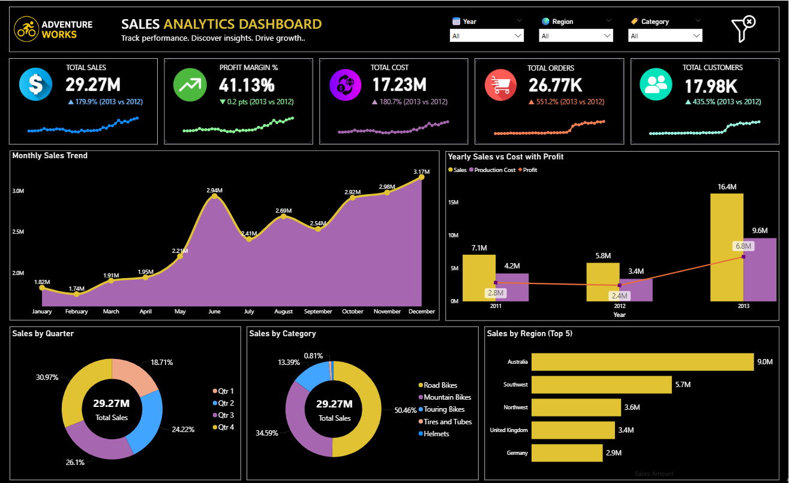

# Adventure Works Sales Analytics Dashboard (Power BI)

A single-page, dark-themed Power BI dashboard that tracks sales performance for Adventure Works. It shows headline KPIs with year-over-year comparison, sales trends, and breakdowns by quarter, product category and region.

## Dashboard Preview



## Objectives
- Track sales, cost, margin, orders and customers at a glance
- Compare each KPI with the previous year, with the compared years shown on the card
- Understand how sales move over time and which categories and regions drive them
- Let users filter the whole page by year, region and product category

## Dataset
Adventure Works sales data, modelled as a `Sales` table (order lines with sales amount, production cost and profit) connected to dimension tables.

| Table | Description |
|---|---|
| `Sales` | Order lines with amounts, cost, profit, order and customer keys |
| `DimDate` | Date dimension |
| `Dimcustomer` | Customer details |
| `DimProdCategory` / `DimProdSubCategory` | Product category hierarchy |
| `DimSalesTerritory` | Sales regions |

**Data scope:** the report is filtered to **2011–2013**. Rows for 2010 (14 rows) and 2014 (1,970 rows with almost no sales) are excluded, because they would distort the trend charts and the year-over-year comparison.

## Dashboard Components

### KPI Cards (with year-over-year change)
| KPI | Comparison shown |
|---|---|
| Total Sales | % change vs previous year |
| Profit Margin % | Change in percentage points vs previous year |
| Total Cost | % change vs previous year |
| Total Orders | % change vs previous year |
| Total Customers | % change vs previous year |

Each card carries its own year label, for example "2013 vs 2012", and a monthly sparkline.

### Visuals
- **Monthly Sales Trend**: sales by calendar month
- **Yearly Sales vs Cost with Profit**: sales and production cost columns with a profit line
- **Sales by Quarter**: donut
- **Sales by Category**: donut
- **Sales by Region (Top 5)**: bar chart

### Slicers
Year, Region, Category, plus a clear-filters button.

## Key DAX Measures
The year comparison compares the latest year **that has sales** in view with the year before it, so it works with or without a Year selection.

```DAX
Selected Year =
MAXX (
    FILTER ( VALUES ( Sales[Year] ), [Total Sales] > 0 ),
    Sales[Year]
)

Sales PY =
VAR CurrentYear = [Selected Year]
RETURN
    CALCULATE (
        [Total Sales],
        REMOVEFILTERS ( Sales ),
        Sales[Year] = CurrentYear - 1
    )

Sales Growth % =
VAR CurrentYear = [Selected Year]
VAR CurrentSales =
    CALCULATE ( [Total Sales], Sales[Year] = CurrentYear )
RETURN
    IF (
        ISBLANK ( [Sales PY] ),
        BLANK (),
        DIVIDE ( CurrentSales - [Sales PY], [Sales PY] )
    )

Growth Indicator =
VAR CurrentYear = [Selected Year]
RETURN
    IF (
        ISBLANK ( [Sales PY] ),
        "N/A",
        IF ( [Sales Growth %] >= 0, "▲ ", "▼ " )
            & FORMAT ( ABS ( [Sales Growth %] ), "0.0%" )
            & " (" & CurrentYear & " vs " & ( CurrentYear - 1 ) & ")"
    )

Margin Change (pts) =
VAR CurrentYear = [Selected Year]
VAR CY =
    CALCULATE ( [Profit Margin %], Sales[Year] = CurrentYear )
VAR PY =
    CALCULATE (
        [Profit Margin %],
        REMOVEFILTERS ( Sales ),
        Sales[Year] = CurrentYear - 1
    )
RETURN
    IF (
        ISBLANK ( PY ) || ISBLANK ( CY ),
        "N/A",
        IF ( CY - PY >= 0, "▲ ", "▼ " )
            & FORMAT ( ABS ( CY - PY ) * 100, "0.0" )
            & " pts (" & CurrentYear & " vs " & ( CurrentYear - 1 ) & ")"
    )
```

The cost, orders and customers cards use the same pattern with their own measures.

## Observations
- Sales by year: about 7.1M (2011), 5.8M (2012) and 16.4M (2013).
- 2013 vs 2012: sales grew about 180% and cost about 181%, while the profit margin moved down 0.2 points (41.4% vs 41.6%).
- Orders (+551%) and customers (+436%) grew far faster than sales in 2013, which suggests smaller average order values.
- Road Bikes make up about half of sales (50%), followed by Mountain Bikes (35%) and Touring Bikes (13%).
- Australia is the largest region at 9.1M, followed by Southwest at 5.7M.
- Sales are highest in Q4 (31%) and lowest in Q1 (19%) when all years are combined.

## Design Notes
- Dark theme with yellow and purple accents
- Custom icons on each KPI card
- Sparklines built on a continuous monthly date axis
- Growth labels state the compared years so the percentage cannot be misread
- Partial years (2010 and 2014) removed with a page-level filter

## How to Use
1. Download the `.pbix` file and the data files.
2. Open the `.pbix` in Power BI Desktop.
3. If you moved the data files, update the paths in **Transform data → Data source settings → Change Source**.
4. Use the Year, Region and Category slicers to explore the data. The clear-filters button resets them.

## Tools
- Power BI Desktop (DAX, Power Query, data modelling)

## Author

Vaibhav Gharpankar

LinkedIn: https://www.linkedin.com/in/vaibhav-gharpankar-502b37343/
